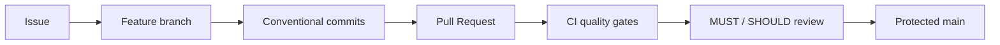

# ArtworkGuard 기여 가이드

## 1. 결정 사항 및 배경 (ADR)

ArtworkGuard는 `main`을 배포 가능한 기준선으로 유지하고 모든 변경을 짧게 유지되는 feature 브랜치와 Pull Request로 통합한다. 변경 이력은 Conventional Commits로 통일해 기능·수정·테스트·문서·CI 변경을 추적할 수 있게 한다.

브랜치 이름은 변경 의도를 드러내는 `feature/<topic>`, `fix/<topic>`, `docs/<topic>`, `ci/<topic>` 형식을 권장한다. 긴 작업은 독립적으로 검증 가능한 작은 PR로 나눈다.

## 2. 아키텍처 설계

`main`에 직접 기능 커밋을 만들지 않는다. PR은 템플릿의 테스트·보안·문서 체크리스트를 작성하고 CODEOWNERS 검토와 필수 CI를 통과한 뒤 병합한다.

## 3. API 명세

API를 변경하는 PR은 다음을 함께 제출한다.

- OpenAPI/Swagger 계약과 요청·응답 예시
- 인증·인가 및 소유권 경계
- 정상·경계·실패 경로 테스트
- 호환성 영향과 마이그레이션 방법

API 변경이 없으면 PR 본문에 `API 변경 없음`이라고 명시한다.

## 4. 트러블슈팅 가이드

- 원격 브랜치가 뒤처졌다면 `main`의 최신 변경을 feature 브랜치에 반영하고 충돌을 해당 브랜치에서 해결한다.
- CI 실패를 재실행만으로 숨기지 말고 실패 로그와 재현 명령을 PR에 기록한다.
- Docker가 필요한 통합 테스트와 로컬 단위 테스트 결과를 구분한다.
- 비밀값을 커밋했다면 단순 삭제로 끝내지 않고 값을 폐기·회전한 뒤 이력을 점검한다.
- 리뷰어가 `[MUST]`를 남겼다면 수정 커밋과 검증 결과로 해결 근거를 답변한다.

## 5. 회의 노트 및 액션 아이템

PR 작성자는 다음 순서로 작업한다.

1. 관련 Issue와 완료 조건을 확인한다.
2. feature 브랜치를 생성한다.
3. 작은 단위로 구현하고 테스트한다.
4. `feat`, `fix`, `refactor`, `perf`, `test`, `style`, `docs`, `chore`, `ci` 중 맞는 Conventional Commit 타입을 사용한다.
5. 민감정보 검사를 수행하고 PR 템플릿을 작성한다.
6. `[MUST]`와 `[SHOULD]` 리뷰를 반영하고 CI 통과 후 병합한다.

커밋 예시는 `feat: add detection report export`, `fix: reject unsafe product URL`, `docs: document DORA collection`이다.

## 6. FAQ 및 Onboarding

### 하나의 커밋에 여러 타입을 섞어도 되나요?

가능하면 나눈다. 코드와 문서가 하나의 기능 완료에 필수라면 대표 목적에 맞는 타입을 선택한다.

### `[MUST]`와 `[SHOULD]`의 차이는 무엇인가요?

`[MUST]`는 병합 전 해결해야 하는 문제이고 `[SHOULD]`는 후속 개선도 가능한 권고다. 상세 기준은 [리뷰 가이드](docs/REVIEW_GUIDE.md)를 따른다.

### 민감정보는 어디에 저장하나요?

로컬 환경변수 또는 승인된 GitHub Secrets를 사용한다. 실제 값은 코드, 문서, Issue, PR, 리뷰 코멘트에 기록하지 않는다.

