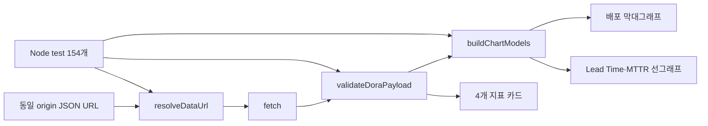

# STEP 36 DORA Chart.js 대시보드 검증·테스트 확장

작성일: 2026-10-06. 상태: **로컬 PASS — 154개 신규 테스트와 브라우저 렌더링 확인, 원격 CI 대기**.

## 1. 결정 사항 및 배경 (ADR)

기존 대시보드는 Chart.js 막대·선 그래프를 생성했지만 로직이 `index.html` 인라인 스크립트에 묶여 있었고 자동 테스트가 없었다. `?data=`가 가리키는 JSON 구조와 수치 범위도 검증하지 않아 손상된 보고서가 조용히 잘못 표시될 수 있었다.

다음과 같이 결정했다.

- 화면 로딩은 `app.mjs`, 순수 검증·변환은 `lib.mjs`로 분리한다.
- 데이터 URL은 동일 origin의 HTTP(S) `.json` 파일만 허용한다.
- DORA 네 지표와 주간 시계열의 자료형·범위·날짜·정렬을 화면 표시 전에 검증한다.
- Node.js 내장 테스트 러너로 154개 케이스를 실행하고 Application CI의 독립 Job으로 등록한다.

Chart.js는 기존 4.4.7 CDN을 유지한다. 버전 갱신은 시각 회귀와 CDN/SRI 정책을 함께 결정할 별도 변경으로 분리한다.

## 2. 아키텍처 설계

브라우저 DOM과 Chart.js 생성은 `app.mjs`가 담당하고, Node 환경에서 검증 가능한 함수는 `lib.mjs`에 둔다. 따라서 DOM 라이브러리 의존 없이 경계값과 실패 경로를 빠르게 검증한다.

## 3. API 명세

HTTP API 변경은 없다. 대시보드 모듈 인터페이스는 다음과 같다.

| 함수 | 입력 | 출력/오류 |
| --- | --- | --- |
| `formatValue(value, suffix)` | 숫자·숫자 문자열·null | 한국어 숫자 문자열 또는 `N/A` |
| `resolveDataUrl(search, baseHref)` | 쿼리 문자열과 현재 URL | 동일 origin JSON 절대 URL; 위반 시 `TypeError` |
| `validateDoraPayload(payload)` | DORA JSON 객체 | 검증된 원본 객체; 스키마·범위 위반 시 오류 |
| `buildChartModels(series)` | 검증된 주간 배열 | 라벨·성공/실패·Lead Time·MTTR 배열 |

## 4. 트러블슈팅 가이드

| 증상 | 원인 확인 | 해결 |
| --- | --- | --- |
| `Chart.js를 불러오지 못했습니다` | CDN 차단·오프라인 여부 | 네트워크 정책을 확인하거나 승인된 로컬 번들 전략을 별도 적용 |
| JSON 로드 오류 | 루트 HTTP 서버, 경로, same-origin 여부 | 저장소 루트에서 서버를 실행하고 `.json` 상대 경로 사용 |
| 스키마 오류 | notice에 표시된 필드명 | 수집기 출력 스키마와 대시보드 계약을 함께 수정 |
| 주차 정렬 오류 | 중복 또는 내림차순 `week_start` | 수집기에서 주차를 오름차순·중복 없이 생성 |
| 차트가 빈 화면 | null만 있는 시계열인지 확인 | 데이터 없음과 로딩 실패를 구분하고 카드의 `N/A` 확인 |

## 5. 회의 노트 및 액션 아이템

별도 회의는 없었다. 사용자의 Chart.js 생성 여부 확인과 100개 이상 테스트 요청을 근거로 대시보드 안정성을 우선 보완했다.

| 항목 | 결과/담당 | 상태 |
| --- | --- | --- |
| 기존 Chart.js 실제 렌더링 확인 | 개발 | 완료 |
| 순수 모듈 분리 | 개발 | 완료 |
| 100개 이상 신규 테스트 | 개발 | 완료 — 154개 |
| Application CI에 대시보드 Job 추가 | 개발 | 완료, 원격 실행 대기 |
| 실측 DORA 데이터로 샘플 교체 | 운영 담당 | 미완료 |
| Chart.js 로컬 번들·SRI 정책 | 프로젝트 담당자 | 미정 |

## 6. FAQ 및 Onboarding

### Chart.js가 실제로 생성되나요?

그렇다. 로컬 HTTP 실행에서 4개 지표 카드와 `deploymentsChart`, `timeChart` 두 캔버스의 그래프 렌더링을 확인했고 콘솔 경고·오류는 0건이었다.

### 154개 테스트는 무엇을 검증하나요?

숫자 표시, 안전한 JSON 경로, 필수 필드와 수치 범위, 날짜·주차 정렬, null 처리, 차트 배열 변환을 각각 독립 테스트로 검증한다.

### 현재 화면이 운영 실측인가요?

아니다. `reports/dora/latest.json`의 `source.mode`가 `sample`이고 화면에도 `SAMPLE DATA`를 명시한다. 실제 Deployment와 incident 기록이 쌓인 뒤 DORA 워크플로우를 실행해야 한다.

### 로컬 실행 방법은 무엇인가요?

저장소 루트에서 HTTP 서버를 실행하고 `/dashboard/`에 접속한다. 테스트는 `dashboard` 디렉터리에서 `npm test`로 실행한다.
