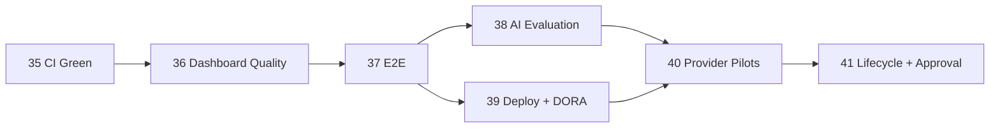

# STEP 37~41 잔여 개발 백로그

작성일: 2026-10-06. 상태: **계획 초안 — GitHub 이슈·마일스톤 반영 전**.

## 1. 결정 사항 및 배경 (ADR)

STEP 33 로컬 MVP와 STEP 34 품질 게이트 이후 남은 범위를 코드로 해결 가능한 품질 작업과 외부 권한·운영 결정이 필요한 작업으로 분리한다. 완료된 로컬 fixture 시험을 실제 마켓·결제·법률 승인으로 과장하지 않는다.

| Step | 목표 | 현재 부족분 | 완료 조건 |
| --- | --- | --- | --- |
| 35 | 애플리케이션 원격 CI | 백엔드 통합 Job 실패 상세 분석 | 모든 원격 Job PASS, 보호 규칙 후보 확정 |
| 36 | DORA 대시보드 검증 | 실측 데이터·CDN 공급망 정책 없음 | 154개 테스트와 원격 Job PASS, 실측 전환 이슈 연결 |
| 37 | E2E 스모크·fixture 정리 | 기존 이슈 #2·#3 미완료 | 가입→업로드→탐지→검토 핵심 경로 자동화 |
| 38 | 실제 AI 평가·임계값 | 합성 fixture 중심, 실제 권리 데이터 부족 | 승인 데이터셋과 precision/recall·임계값 보고 |
| 39 | 배포·DORA 운영화 | 배포 대상·incident·실측 없음 | 실제 Deployment와 incident 기반 첫 보고 |
| 40 | 외부 공급자 파일럿 | AliExpress·SMTP·S3·Stripe 실권한 미검증 | 최소 권한 샌드박스/파일럿 결과와 철회 절차 |
| 41 | 데이터 수명주기·복구·법률 승인 | 물리 삭제·복구 훈련·정책 승인 미완료 | 삭제/복구 증거와 승인된 정책·런북 |

## 2. 아키텍처 설계

STEP 38~41은 외부 데이터·계정·승인이 필요하므로 비밀값을 저장소나 이슈 본문에 기록하지 않는다.

## 3. API 명세

이 문서는 API를 추가하지 않는다. 각 Step에서 API가 변경되면 Swagger/OpenAPI 계약, 인증·권한, 정상·경계·실패 응답을 해당 Step 문서와 테스트에 함께 반영한다. STEP 40의 외부 API 자격증명은 GitHub Secrets 또는 승인된 비밀 저장소의 이름만 문서화하고 값은 기록하지 않는다.

## 4. 트러블슈팅 가이드

- 외부 권한이 없으면 Mock 성공을 실제 연동 성공으로 표시하지 않고 `BLOCKED`로 기록한다.
- 실제 사용자·작품 데이터를 평가에 쓰기 전 권리·동의·보유기간을 확인한다.
- 원격 CI 실패는 테스트 XML을 기준으로 애플리케이션 실패와 Runner 실패를 구분한다.
- DORA 값이 null이면 0으로 치환하지 않고 필요한 이벤트가 실제로 존재하는지 확인한다.
- 삭제·복구 시험은 운영 데이터가 아닌 격리 fixture와 검증된 백업으로 수행한다.

## 5. 회의 노트 및 액션 아이템

별도 회의는 없었다. 2026-10-06 사용자 요청에 따라 모든 잔여 Step을 GitHub 이슈와 마일스톤으로 추적하기로 했다.

| 작업 | 연결 대상 | 예정 마일스톤 |
| --- | --- | --- |
| STEP 35 이슈 생성 | 신규 | 품질 자동화 |
| STEP 36 이슈 생성 | 신규 | 품질 자동화 |
| STEP 37 정리 | 기존 #2·#3 | 품질 자동화 |
| STEP 38 정리 | 기존 #4 | 운영 준비 |
| STEP 39 정리 | 기존 #6~#9 | 운영 준비 |
| STEP 40 정리 | 기존 #12 | 운영 준비 |
| STEP 41 이슈 생성 | 신규 | 운영 준비 |
| 완료된 #1·#5 검토 | 기존 이슈 | 과거 Sprint 정리 |

## 6. FAQ 및 Onboarding

### 왜 STEP 37부터 바로 외부 연동을 하지 않나요?

원격 CI와 E2E가 안정되어야 외부 연동 실패를 애플리케이션 회귀와 구분할 수 있기 때문이다.

### 모든 Step이 코드 작업인가요?

아니다. 실제 데이터 권리, 공급자 계정, 결제, 법률 승인과 복구 훈련은 프로젝트 담당자의 권한·결정이 필요하다.

### 이슈에는 무엇을 기록하나요?

목표, 수용 조건, 테스트, 차단 요소, 연결 문서를 기록한다. 비밀번호·토큰·개인정보·내부 절대 경로는 기록하지 않는다.

### 마일스톤은 어떻게 구성하나요?

활성 마일스톤을 `STEP 35~37 품질 자동화`와 `STEP 38~41 운영 준비` 두 묶음으로 두고, 과거 Sprint는 열린 이슈를 이동·정리한 뒤 닫는다.
